<!--
  GITHUB PROFILE README — Muhammed Radin (@muhammed-radin)
  Profile cards are generated into ./assets by .github/workflows/profile-cards.yml.
-->

    

    
    
    
    
  

whoami — About me
I'm Muhammed Radin, a full-stack developer and independent builder from Kerala, India. I enjoy turning ideas into practical digital experiences — from thoughtful interfaces and reliable APIs to database architecture and complete web applications.

My work is rooted in JavaScript and the modern web ecosystem, while my curiosity extends to artificial intelligence, machine learning, game development, and connected systems. I like understanding a problem deeply, designing a clean solution, and building it end to end.
Build with purpose. Learn by experimenting. Keep improving.

What I do
<table>
  <tr>
    <td width="50%" valign="top">
      <h3>◈ Full-stack development</h3>
      
Building responsive web applications, reusable interfaces, backend services, REST APIs, authentication flows, and database-driven systems.

    </td>
    <td width="50%" valign="top">
      <h3>⌘ Architecture & databases</h3>
      
Structuring application architecture, designing data models, integrating services, and thinking about security, maintainability, and scale.

    </td>
  </tr>
  <tr>
    <td width="50%" valign="top">
      <h3>✳ AI & machine learning</h3>
      
Exploring neural networks, model training, decision-making systems, and practical ways to integrate AI into software.

    </td>
    <td width="50%" valign="top">
      <h3>▧ Interactive experiences</h3>
      
Experimenting with browser-based graphics, 2D and 3D technologies, game development, and IoT prototypes.

    </td>
  </tr>
</table>Tech stack & tools
Languages

  

Frontend & UI

  

Backend & databases

  

Tools, graphics & AI

  

  
  
  
  

Also familiar with: Better Auth, authentication and authorization, Firebase Firestore and Realtime Database, React PWAs, Anime.js, Handlebars.js, Phaser.js, PixiJS, PlayCanvas, neural networks, model training, decision-making AI, and IoT prototyping.
GitHub overview

  <picture>
    <source media="(prefers-color-scheme: dark)" srcset="./assets/overview.dark.svg" />
    
  </picture>
   
  <picture>
    <source media="(prefers-color-scheme: dark)" srcset="./assets/languages.dark.svg" />
    
  </picture>
   
  <picture>
    <source media="(prefers-color-scheme: dark)" srcset="./assets/contributions.dark.svg" />
    
  </picture>
   
  <picture>
    <source media="(prefers-color-scheme: dark)" srcset="./assets/lifetime.dark.svg" />
    
  </picture>

Profile cards are generated and committed to this repository by GitHub Actions. To preview them locally, make sure the generated assets/ folder is present in your clone.
Beyond the code
- Product mindset: I think about the problem and user experience before choosing the tools.
- Continuous learning: I learn through building, testing, debugging, and refining real implementations.
- Independent work: Freelance developer since 2022, working across ideas, design, development, and delivery.
Let's connect
Have an idea, a collaboration in mind, or want to talk about software development and AI? Reach out.

  <a href="https://muhammed-radin.github.io/">Portfolio</a>
  &nbsp;·&nbsp;
  <a href="https://www.linkedin.com/in/mhd-radin">LinkedIn</a>
  &nbsp;·&nbsp;
  <a href="mailto:radinpaliyalill@gmail.com">radinpaliyalill@gmail.com</a>
  &nbsp;·&nbsp;
  <a href="https://github.com/muhammed-radin">GitHub</a>
    
  Designed with intention. Built with curiosity. Maintained by Muhammed Radin.

  

